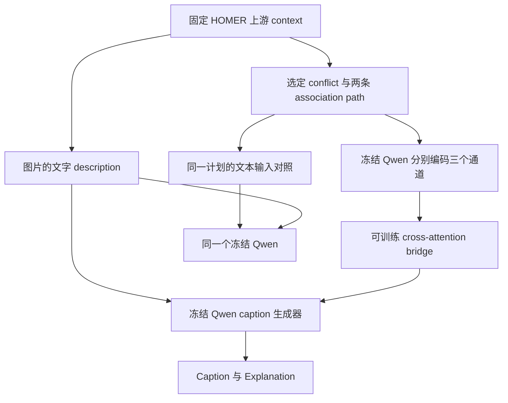

# v3.5 latent 修复：PR 审阅指南

## 要解决的问题

历史实现的文本分支收到最终选定计划，而 latent 分支读取早期 planner trace；因此不能将二者差异解释为同一信息的通信形式差异。此次将训练与生成统一为“最终选定计划的冻结编码”，并修正目标格式、评测失败处理、checkpoint 选择与运行证据。

## 方法流程与边界

- caption 生成阶段没有原图输入；使用 Qwen2.5-VL 权重不等于调用视觉输入。
- latent 表示来自选定文本，不是未经文本表达的隐藏推理。
- 只训练 bridge；不更新 Qwen。编码计划增加前向成本，不预先声称节省计算。
- 监督只包含 `##Caption: <human caption>`，不编造 Explanation；生成时的解释格式仍需检验。
- no-memory 是与 latent 相同提示下关闭 bridge 的机制对照，不是独立优化的直接生成 baseline。

## 建议按以下顺序审阅

| 顺序 | 文件 | 核心检查 |
|---|---|---|
| 1 | `src/humor_generator_v35/training/selected_plan.py` | 编码输入是否只取选定 conflict/两条 path，训练与生成是否共用 |
| 2 | `training/public_bridge.py`、`training/formal_bridge.py`、`qwen_backend.py` | 文本/latent 条件信息、开放 assistant 目标及 token 对齐 |
| 3 | `training/cross_attention_bridge.py`、`training/losses.py` | NLL、教师 KL、分步 margin 梯度、matched/no-memory/shuffled 指标 |
| 4 | `training/checkpoint_selection.py`、`scripts/train_bridge.py` | 验证指标选 checkpoint、恢复时指标一致性，科学 gate 与运行完成分离 |
| 5 | `homer/caption_parsing.py` 与生成/建包/聚合/finalize 脚本 | 严格解析、失败计分、完整 trial/image 集与 provenance |
| 6 | `scripts/real_trace_bridge_smoke.py`、`jobs/v35_selected_plan_smoke.pjm` | 实际 memory 与文本长度压力样本、有限梯度、冻结约束、源码/配置记录 |
| 7 | `tests/test_review_repairs.py`、`test_split_backward_equivalence.py`、`test_bridge_token_causality.py`、`test_checkpoint_selection.py` | 反例是否被覆盖，测试范围是否足以支持对应结论 |

上表中 `training/` 与 `homer/` 简写均相对 `src/humor_generator_v35/`。

## 损失与选择规则

基础配置使用 L = NLL + 0.5 KL + 0.5 softplus(0.2 - s_matched + s_shuffled)，s 为平均目标 token log-probability。分步重算的一阶梯度经过独立完整计算图对照，要求确定性前向且分支间不更新权重。

NLL 改为对 logits.float() 计算交叉熵。真实 GPU smoke 的 BF16 NLL 约 3，舍入间距约 0.015625，而机制阈值包含 0.01；保留 BF16 汇总会掩盖小幅变化。FP32 只改善损失计算精度，不恢复量化模型丢失的信息。

`configs/pilot/v35_selected_plan_ablations/` 准备 NLL / NLL+KL / NLL+KL+margin 三组探索性配置，统一按验证 caption_nll 选 checkpoint；未启动训练。历史配置默认仍按 total，不改变历史含义。

## 已有证据与不能得出的结论

- 真实 GPU job 7091538：H100，两个训练 cluster、一次 bridge 更新；冻结基础模型 trainable=0，bridge trainable=6,949,572，梯度范数约 0.704，更新范数约 0.262。峰值 allocated 6.40 GiB、reserved 6.56 GiB。
- **该 GPU 运行早于 FP32 NLL 修复**。它证明原运行版本工程路径能执行，不能视为当前 PR 全部代码的真实 GPU 认证；需要复跑。
- 真实本地 processor 检查 813 条训练、132 条验证 caption：两侧目标 token 一致，无 EOS，最长目标 44 tokens；未使用测试集生成。
- CPU 完整单元及集成测试：187 passed in 239.40s。结构化证据见 `validation_evidence.json`。
- 固定 8 个训练 cluster 的定性审阅发现部分计划不支持人类 caption 的具体笑点；没有总体失配率或独立标注共识。详见 `ALIGNMENT_FINDINGS_ZH.md`。
- 严格解析/失败计分是 HOMER 指标协议的显式扩展，不能叫原样官方复现。

## Review 时应重点讨论的未解决问题

- [ ] 人类 caption 与独立选定计划的语义兼容性如何标注和验证？
- [ ] NLL、KL、margin 各自是否带来验证及幽默质量收益？
- [ ] 正确计划是否改善结果，而不仅是错误计划使结果变差？
- [ ] 简单投影与直接 SFT 强基线尚需完成。
- [ ] 真实生成的 KV cache、格式成功率、重复与拒答需要验证。
- [ ] 独立测试集盲评、多参考组区间与实际成本报告尚未完成。

请在 GitHub 的 **Files changed → 点击行号 → Start a review** 中标注问题；方法层面的建议放在 PR Conversation。PR 为草稿，不自动合并，不以测试通过宣称科学问题全部解决。

## 论文依据

- [HOMER, ICLR 2026](https://arxiv.org/abs/2602.06423)：规划与评测框架。
- [BLIP-2, ICML 2023](https://proceedings.mlr.press/v202/li23q.html)：冻结骨干与可训练接口先例。
- [Humor in AI, NeurIPS 2024](https://arxiv.org/abs/2406.10522)：幽默 caption 和后训练基线。
- [Cawley & Talbot, JMLR 2010](https://jmlr.org/papers/v11/cawley10a.html)：模型选择偏差及独立评估的重要性。

这些论文不替代本项目的实现证据和实验结果。
